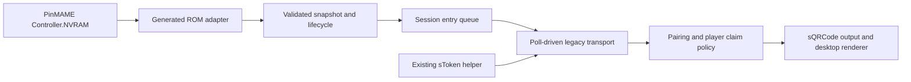

# Architecture and interface contracts

Start with the [community overview](community.md) for nontechnical context and
the [protocol reference](protocol.md) for implemented request/response behavior.

The table owns its controller, timer and render objects. The shared host polls
memory and transport; it cannot manufacture missing events or decide a correct
catalog identity. Generated adapters isolate ROM offsets from table wiring.

The builder combines the adapter and shared modules into one table script.
The AI skill helps developers investigate and validate; it is not part of the
runtime. Python reference decoding and the optional SDK bridge are separate
developer/experimental paths, not extra processes required by the default runtime.

| Interface | Contract |
|---|---|
| `SBDecode(nv, actualRom)` | Exact ROM guard; zero-based 12,288-byte RAM or 12,334-byte full snapshot; returns a new validated `SBRomSnapshot` or raises |
| `SBRomSnapshot` | Boolean game-over; 0–4 seats; active player 1–seat count and ball 1–9; four integer scores from 0 to 9,999,999,999; numeric strings rejected |
| `SBLifecycle.Feed(s, nowMs)` | Monotonic milliseconds, normally every 200 ms; copies retained state; returns none/start/update/finish/abort; gaps or resets never produce finish |
| `SBEntryQueue` | One open game; immutable queued head; final scores and finish together; acknowledges exact local head ID, distinct from transmitted per-session sequence |
| `SBHttpTransport.Tick(nowMs)` | Nonblocking polling; production/staging host allowlist; parses/validates full response before acknowledgment or pairing-state changes; retains unacknowledged entries |
| `SBHelpers` / helper bootstrap | Existing executable hashes are reviewed separately; private per-table output state; never log tokens or package device state |
| QR host policy | Attract pairing / safe-window unclaimed-player display; wall-clock timeout; hides desktop surface in VR pending implementation |

The JSON reader caps responses at 65,536 UTF-16 code units (VBScript `Len`),
not 64 KiB of HTTP bytes, and nesting at 32. These bounds reduce
work on the table timer. No server response is evaluated as VBScript.

The lifecycle needs observed attract before a fresh player-1/ball-1 start.
End-state stability is time-based in VBS (default 2 seconds). Score/seat regression,
clock reset or an excessive polling gap aborts locally. Rollover and late attach
are unsupported. The queue is in memory only; closing VPX can lose pending entries.
401/403 disables transport; automatic token refresh is not implemented.

The optional Python lifecycle is an older two-snapshot diagnostic model, not the
player host's time-based state machine. Python's map parser is a pinned upstream
reference with strict validation; it does not run on player machines.

Protocol assumptions and open questions are summarized in the
[Scorbit technical brief](scorbit-review.md). Unit tests validate local contracts,
not server-side idempotency, accepted event taxonomies or catalog authorization.
